<a href="https://swarshinde.dev"><picture><source media="(prefers-color-scheme: dark) and (max-width: 600px)" srcset="assets/hero-phone-dark.svg"><source media="(max-width: 600px)" srcset="assets/hero-phone-light.svg"><source media="(prefers-color-scheme: dark)" srcset="assets/hero-dark.svg">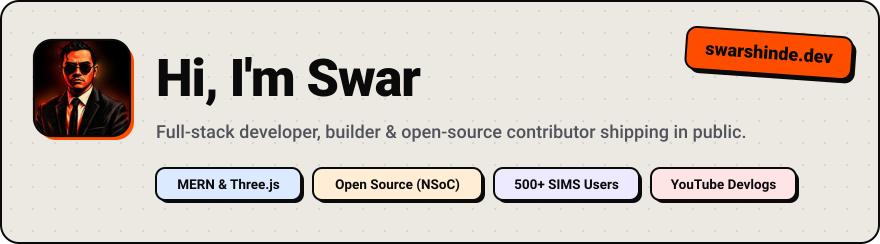</picture></a>

<a href="https://www.youtube.com/@Swardevv"><picture><source media="(prefers-color-scheme: dark)" srcset="assets/badge-yt-dark.svg"></picture></a>
<a href="https://x.com/Swars_page"><picture><source media="(prefers-color-scheme: dark)" srcset="assets/badge-x-dark.svg"></picture></a>
<a href="https://www.linkedin.com/in/swar-shinde-91131a2b9/"><picture><source media="(prefers-color-scheme: dark)" srcset="assets/badge-li-dark.svg"></picture></a>
<a href="https://swarshinde.dev"><picture><source media="(prefers-color-scheme: dark)" srcset="assets/badge-site-dark.svg"></picture></a>

<picture><source media="(prefers-color-scheme: dark) and (max-width: 600px)" srcset="assets/github-phone-dark.svg"><source media="(max-width: 600px)" srcset="assets/github-phone-light.svg"><source media="(prefers-color-scheme: dark)" srcset="assets/github-dark.svg">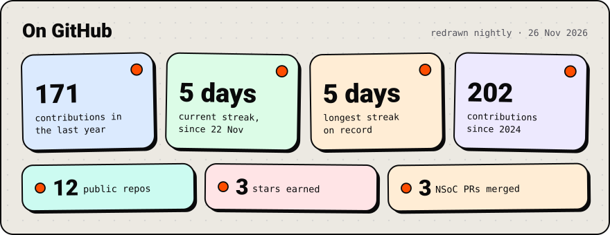</picture>

<picture><source media="(prefers-color-scheme: dark) and (max-width: 600px)" srcset="assets/graph-6m-phone-dark.svg"><source media="(max-width: 600px)" srcset="assets/graph-6m-phone-light.svg"><source media="(prefers-color-scheme: dark)" srcset="assets/graph-6m-dark.svg">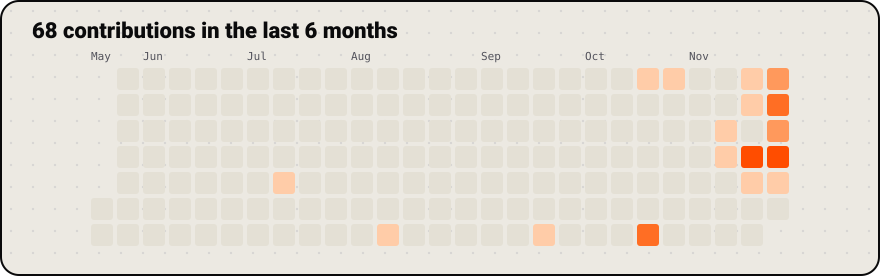</picture>

Last 12 months: 171 contributions

<picture><source media="(prefers-color-scheme: dark) and (max-width: 600px)" srcset="assets/graph-12m-phone-dark.svg"><source media="(max-width: 600px)" srcset="assets/graph-12m-phone-light.svg"><source media="(prefers-color-scheme: dark)" srcset="assets/graph-12m-dark.svg">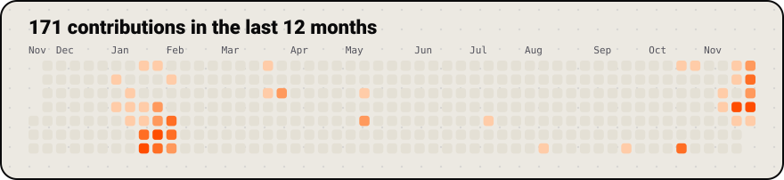</picture>

2026: 171 contributions

<picture><source media="(prefers-color-scheme: dark) and (max-width: 600px)" srcset="assets/graph-2026-phone-dark.svg"><source media="(max-width: 600px)" srcset="assets/graph-2026-phone-light.svg"><source media="(prefers-color-scheme: dark)" srcset="assets/graph-2026-dark.svg">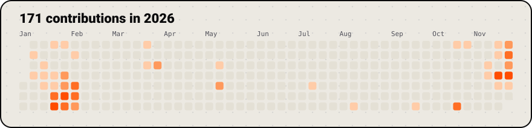</picture>

2025: 30 contributions

<picture><source media="(prefers-color-scheme: dark) and (max-width: 600px)" srcset="assets/graph-2025-phone-dark.svg"><source media="(max-width: 600px)" srcset="assets/graph-2025-phone-light.svg"><source media="(prefers-color-scheme: dark)" srcset="assets/graph-2025-dark.svg">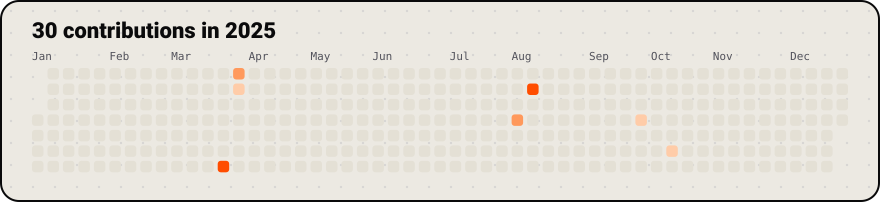</picture>

2024: 1 contribution

<picture><source media="(prefers-color-scheme: dark) and (max-width: 600px)" srcset="assets/graph-2024-phone-dark.svg"><source media="(max-width: 600px)" srcset="assets/graph-2024-phone-light.svg"><source media="(prefers-color-scheme: dark)" srcset="assets/graph-2024-dark.svg">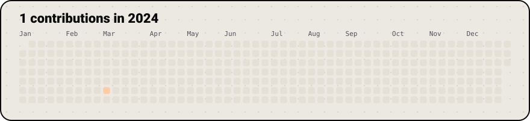</picture>

<picture><source media="(prefers-color-scheme: dark) and (max-width: 600px)" srcset="assets/line-30d-phone-dark.svg"><source media="(max-width: 600px)" srcset="assets/line-30d-phone-light.svg"><source media="(prefers-color-scheme: dark)" srcset="assets/line-30d-dark.svg">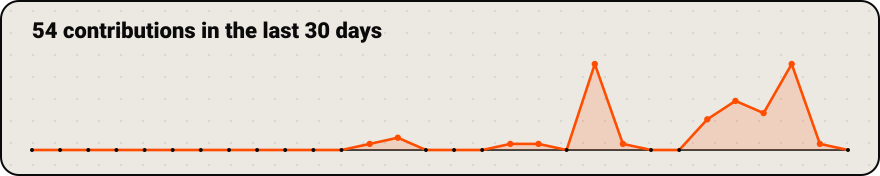</picture>

<picture><source media="(prefers-color-scheme: dark) and (max-width: 600px)" srcset="assets/whoami-phone-dark.svg"><source media="(max-width: 600px)" srcset="assets/whoami-phone-light.svg"><source media="(prefers-color-scheme: dark)" srcset="assets/whoami-dark.svg"></picture>

<picture><source media="(prefers-color-scheme: dark) and (max-width: 600px)" srcset="assets/label-ship-phone-dark.svg"><source media="(max-width: 600px)" srcset="assets/label-ship-phone-light.svg"><source media="(prefers-color-scheme: dark)" srcset="assets/label-ship-dark.svg">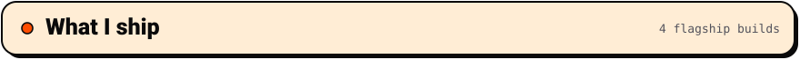</picture>

<a href="https://sims.csidmce.com"><picture><source media="(prefers-color-scheme: dark) and (max-width: 600px)" srcset="assets/app-sims-phone-dark.svg"><source media="(max-width: 600px)" srcset="assets/app-sims-phone-light.svg"><source media="(prefers-color-scheme: dark)" srcset="assets/app-sims-dark.svg">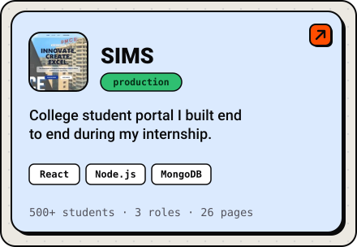</picture></a>
<a href="https://scaffold.swarshinde.dev"><picture><source media="(prefers-color-scheme: dark) and (max-width: 600px)" srcset="assets/app-scaffold-phone-dark.svg"><source media="(max-width: 600px)" srcset="assets/app-scaffold-phone-light.svg"><source media="(prefers-color-scheme: dark)" srcset="assets/app-scaffold-dark.svg">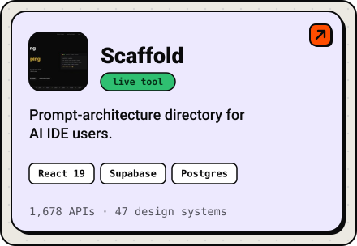</picture></a>
<a href="https://github.com/Swarspage/Singularity"><picture><source media="(prefers-color-scheme: dark) and (max-width: 600px)" srcset="assets/app-singularity-phone-dark.svg"><source media="(max-width: 600px)" srcset="assets/app-singularity-phone-light.svg"><source media="(prefers-color-scheme: dark)" srcset="assets/app-singularity-dark.svg">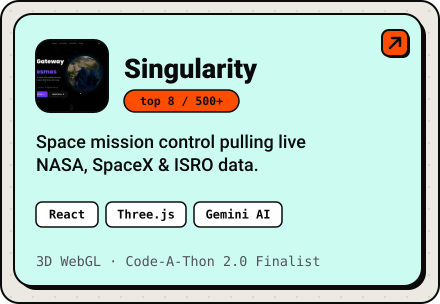</picture></a>
<a href="https://hacktober.swarshinde.dev"><picture><source media="(prefers-color-scheme: dark) and (max-width: 600px)" srcset="assets/app-redflag-phone-dark.svg"><source media="(max-width: 600px)" srcset="assets/app-redflag-phone-light.svg"><source media="(prefers-color-scheme: dark)" srcset="assets/app-redflag-dark.svg">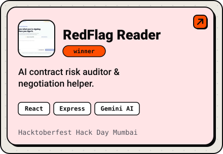</picture></a>

Open Source (NSoC): <a href="https://github.com/KanishJebaMathewM/DSA_Studio/pull/14">DSA Studio PR #14</a> · <a href="https://github.com/KanishJebaMathewM/DSA_Studio/pull/32">PR #32</a> · <a href="https://github.com/breeze-sn/Atria/pull/48">Atria PR #48</a> · more ships: <a href="https://github.com/Swarspage/Recipe-App">Recipe AI</a> · <a href="https://apticore.swarshinde.dev">Aptitude Platform</a> · <a href="https://csi-attendance-web-app.vercel.app/">CSI Attendance</a> · <a href="https://github.com/Swarspage/hacktober-project">RedFlag Repo</a>

<picture><source media="(prefers-color-scheme: dark) and (max-width: 600px)" srcset="assets/label-videos-phone-dark.svg"><source media="(max-width: 600px)" srcset="assets/label-videos-phone-light.svg"><source media="(prefers-color-scheme: dark)" srcset="assets/label-videos-dark.svg">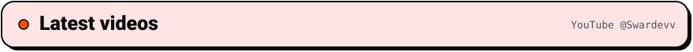</picture>

<a href="https://www.youtube.com/watch?v=lDWuxWCVywc"><picture><source media="(prefers-color-scheme: dark) and (max-width: 600px)" srcset="assets/video-lDWuxWCVywc-phone-dark.svg"><source media="(max-width: 600px)" srcset="assets/video-lDWuxWCVywc-phone-light.svg"><source media="(prefers-color-scheme: dark)" srcset="assets/video-lDWuxWCVywc-dark.svg">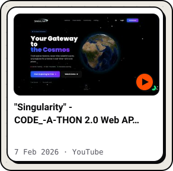</picture></a>
<a href="https://www.youtube.com/watch?v=ZVaLEBNFlzc"><picture><source media="(prefers-color-scheme: dark) and (max-width: 600px)" srcset="assets/video-ZVaLEBNFlzc-phone-dark.svg"><source media="(max-width: 600px)" srcset="assets/video-ZVaLEBNFlzc-phone-light.svg"><source media="(prefers-color-scheme: dark)" srcset="assets/video-ZVaLEBNFlzc-dark.svg">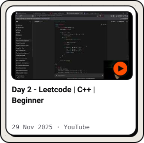</picture></a>
<a href="https://www.youtube.com/watch?v=5Y-RAEXeUjU"><picture><source media="(prefers-color-scheme: dark) and (max-width: 600px)" srcset="assets/video-5Y-RAEXeUjU-phone-dark.svg"><source media="(max-width: 600px)" srcset="assets/video-5Y-RAEXeUjU-phone-light.svg"><source media="(prefers-color-scheme: dark)" srcset="assets/video-5Y-RAEXeUjU-dark.svg">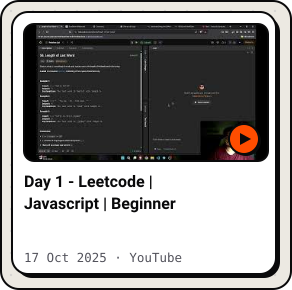</picture></a>

Drawn in Swar's Portfolio V4 design system · numbers and videos redrawn every night by a GitHub Action · <a href="https://swarshinde.dev">swarshinde.dev</a>

